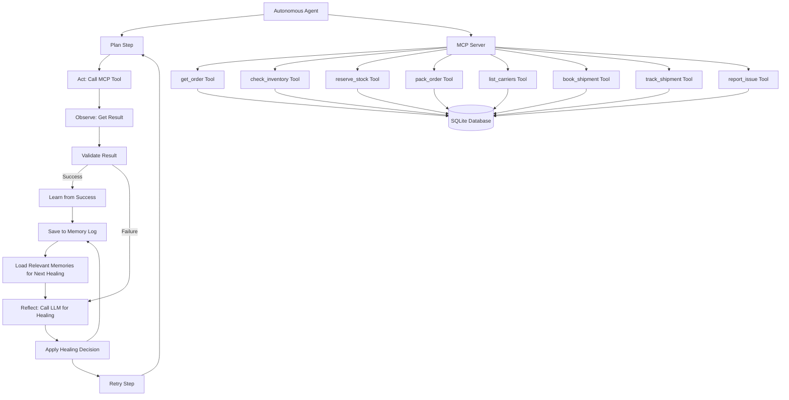

# Logistics Handler - Autonomous Supply Chain Agent

A demo project for Agent Wars hackathon showing an autonomous logistics agent that handles warehouse to shipping operations with self-healing capabilities.

## Features

- Fully automates warehouse (godown) to shipping: receive an order, check stock, pick and pack, assign a carrier, dispatch, and track delivery
- Implements Plan -> Act -> Observe -> Validate -> Reflect -> Retry/Adapt loop with self-healing
- Uses Google's Gemini LLM (via google-genai) for intelligent failure diagnosis and recovery
- MCP server exposes logistics tools (get_order, check_inventory, reserve_stock, etc.)
- Mock data stored in SQLite database
- Memory logging to learn from past failures and improve over time
- Simple CLI to run scenarios

## Tech Stack

- Python 3.11
- Google ADK / google-genai with Gemini as the LLM
- MCP server using the official `mcp` Python SDK (FastMCP)
- SQLite for mock data
- Environment variable configuration (API key in `.env`)

## Project Structure

```
logistics-handler/
├── agent/
│   ├── main.py          # Autonomous agent with self-healing loop
│   ├── requirements.txt # Agent dependencies
│   └── test_*.py        # Test scripts
├── server/
│   ├── main.py          # MCP server exposing logistics tools
│   ├── requirements.txt # Server dependencies
│   └── ... 
├── data/
│   ├── seed_data.json   # Initial mock data (godowns, SKUs, inventory, orders, carriers)
│   ├── logistics.db     # SQLite database (generated from seed data)
│   └── memory_log.json  # Agent's memory of past failures and fixes
├── scenarios/
│   ├── happy_path.py    # Demo: order processes successfully
│   ├── stock_shortage.py # Demo: demonstrates self-healing for stock shortage
│   └── carrier_failure.py # Demo: demonstrates self-healing for carrier issues
├── run_scenarios.py     # Runs all scenarios and shows summary
└── README.md
```

## Setup

1. **Clone the repository**
   ```bash
   git clone <repository-url>
   cd logistics-handler
   ```

2. **Install dependencies**
   ```bash
   # Install server dependencies
   cd server && pip install -r requirements.txt
   
   # Install agent dependencies
   cd ../agent && pip install -r requirements.txt
   ```

3. **Set up environment variables**
   Create a `.env` file in the project root with your Google/Gemini API key:
   ```
   GOOGLE_API_KEY=your_api_key_here
   # or
   GEMINI_API_KEY=your_api_key_here
   ```

4. **Initialize the database**
   The seed data will be automatically loaded when the server starts:
   ```bash
   cd server && python main.py
   ```
   (Leave this running in a terminal or background process)

## Usage

### Running the Demo Scenarios

The easiest way to run all scenarios is with the provided script:

```bash
python run_scenarios.py
```

This will:
1. Start the MCP server in the background
2. Run three scenarios: Happy Path, Stock Shortage, and Carrier Failure
3. Show a summary table of results
4. Stop the MCP server when done

### Running Individual Scenarios

You can also run scenarios individually:

```bash
# Happy Path (should work without healing)
python scenarios/happy_path.py

# Stock Shortage (demonstrates self-healing for inventory issues)
python scenarios/stock_shortage.py

# Carrier Failure (demonstrates self-healing for carrier unavailability)
python scenarios/carrier_failure.py
```

### To See Memory Reuse

Run the stock-shortage scenario twice:
```bash
# First run - will heal and store a fix in memory
python scenarios/stock_shortage.py

# Second run - should reuse the memory fix and heal faster
python scenarios/stock_shortage.py
```

Check the console output - the second run should show fewer retries and mention "REUSED MEMORY FIX".

## How It Works

### Agent Loop

The agent follows this cycle for each step:
1. **Plan**: Define what needs to be done (get order, check inventory, etc.)
2. **Act**: Call the appropriate MCP tool
3. **Observe**: Get the result from the tool call
4. **Validate**: Check if the result matches expectations
5. **Reflect**: If validation failed, use LLM to diagnose and decide on recovery action
6. **Retry/Adapt**: Apply the healing decision and retry (up to max retries)

### Self-Healing with LLM

When a step fails:
1. The agent collects context: failed step, error message, attempt number, order ID, and relevant past experiences from memory
2. This context is sent to Google's Gemini LLM with a prompt to return a structured healing decision
3. The LLM must respond with JSON containing:
   - `diagnosis`: Explanation of what went wrong
   - `recovery_action`: One of ["change_arguments", "switch_tool", "retry_same", "escalate"]
   - `new_arguments`: Arguments to use for retry (if changing arguments)
   - `tool_name`: Tool to use for retry (if switching tools)
   - `confidence`: Confidence score (0.0-1.0)
4. The agent validates the LLM's response and applies the healing decision
5. If the LLM fails to respond or returns invalid JSON, the agent falls back to rule-based healing

### Memory System

- Every failure and successful healing is saved to `data/memory_log.json`
- Before each healing attempt, the agent retrieves the top 3 relevant past experiences
- These experiences are included in the LLM prompt so it can learn from past fixes
- When a healed step succeeds, the agent saves: `{failure_type, diagnosis, action, arguments_changed, outcome}`
- On subsequent similar failures, the agent can reuse proven fixes

## Example Output

See the following output from running the stock-shortage scenario twice:

```
=== First Run ===
[FAIL]Agent successfully connected to MCP server
[OK] Available tools: [...]
[OK] Test call successful: got order response
...
[INFO] Executing step: reserve_stock
[WARNING] Validation failed for reserve_stock: Insufficient stock for SKU001 in godown G001
[INFO] LLM healing decision: {'diagnosis': 'Godown G001 has insufficient stock for SKU001. Need to try alternative godown with available inventory.', 'recovery_action': 'change_arguments', 'new_arguments': {'godown_id': 'G002'}, 'tool_name': 'reserve_stock', 'confidence': 0.9}
[INFO] Healing: Changing arguments for reserve_stock from {'order_id': 'ORD002', 'godown_id': 'G001'} to {'order_id': 'ORD002', 'godown_id': 'G002'}
[INFO] Added memory entry: reserve_stock - Success: stock_reserved
...
```

```
=== Second Run (Memory Reuse) ===
[FAIL]Agent successfully connected to MCP server
[OK] Available tools: [...]
[OK] Test call successful: got order response
...
[INFO] Executing step: reserve_stock
[WARNING] Validation failed for reserve_stock: Insufficient stock for SKU001 in godown G001
[INFO] REUSED MEMORY FIX #1: Trying reserving stock from a different godown with available inventory
[INFO] Healing: Changing arguments for reserve_stock from {'order_id': 'ORD002', 'godown_id': 'G001'} to {'order_id': 'ORD002', 'godown_id': 'G002'}
[INFO] Added memory entry: reserve_stock - Success: stock_reserved
...
```

Notice the second run shows "REUSED MEMORY FIX #1" indicating it learned from the previous run.

## Architecture Diagram



## Customization

- **LLM Model**: Change the model in `agent/main.py` in the `_call_llm_for_healing` method
- **Max Retries**: Adjust `self.max_retries` in the `LogisticsAgent.__init__` method
- **Memory Persistence**: The memory is stored in `data/memory_log.json` - delete this to start fresh
- **Scenarios**: Modify the scenario files in the `scenarios/` directory to test different orders or conditions

## Notes for Demo

- This is a demo project with mock data - no actual shipments occur
- The agent is designed to be extensible for real logistics systems
- In production, you would want to:
  - Add more sophisticated validation
  - Integrate with real ERP/warehouse systems
  - Add proper authentication and authorization for MCP tools
  - Implement more complex healing strategies
  - Add monitoring and alerting

## License

This project is created for the Agent Wars hackathon demo.
